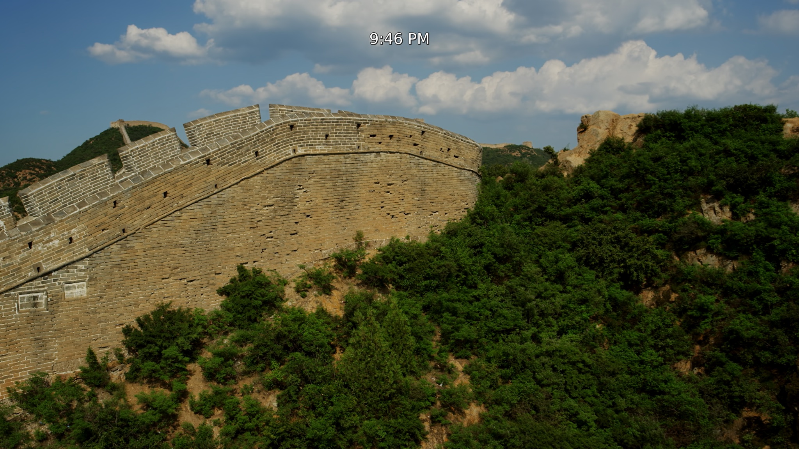

# Aerial for Linux

A native Rust screensaver for Wayland, inspired by [Aerial for macOS](https://github.com/AerialScreensaver/Aerial). Play silent Apple TV aerial videos from a local cache, with hardware decoding and a clock that moves whenever the video changes.



- Shuffled video rotation, with no immediate repeat between activations.
- Clock cycles through eight positions. Location captions are off by default.
- Native Wayland idle detection; keyboard or pointer activity dismisses automatic playback.
- Respects compositor idle inhibitors and checks logind session activity and lock state.
- Offline playback through sandboxed mpv. No Python runtime required by the app.

## Requirements

Linux with a Wayland compositor supporting `ext-idle-notify-v1`, a logind display session, Flatpak, and the [mpv Flatpak](https://flathub.org/apps/io.mpv.Mpv). Tested on Fedora 44 with COSMIC 1.10 and one display. Other compositors and multiple displays need testing; GNOME support is not established. X11 is unsupported.

This is a visual screensaver, not a screen locker. Keep your desktop's normal lock and power settings. Aerial does not configure authentication, screen locking, display power or suspend.

## Build and install

Install a current stable [Rust toolchain](https://rustup.rs/), Git and Flatpak through your distribution. From your desktop session:

```sh
flatpak install --user flathub io.mpv.Mpv
git clone https://github.com/justinbukoski/aerial-linux.git
cd aerial-linux
cargo build --locked --release
bash packaging/install.sh
```

The installer copies the executable to `~/.local/bin`. Ensure that directory is on your `PATH`. It does not download videos or enable automatic startup.

```sh
aerial-linux refresh
aerial-linux list Yosemite
aerial-linux download --search Yosemite --count 1
aerial-linux preview --seconds 20
```

The default catalog prefers 4K SDR; `refresh --hd` selects 1080p when available. Videos can be hundreds of megabytes each. `download --count 6` caches up to six randomly selected videos; repeating it may add more. Downloads use Apple's CDN directly.

Once the preview works, enable login startup and start the watcher:

```sh
aerial-linux install-autostart
aerial-linux watch
```

`watch` stays in the foreground until stopped. On subsequent desktop logins, the autostart entry starts it automatically. There is one watcher per user runtime directory. Press Escape to close a preview, or use `aerial-linux hide`.

## Configuration and controls

`install-autostart` creates `~/.config/aerial-linux/config.json` if absent:

```json
{"idle_seconds":300,"clock":true,"captions":false}
```

Restart the watcher after editing the file. XDG directory overrides are respected.

```sh
aerial-linux status                 # watcher, video and decoder status
aerial-linux hide                   # dismiss current playback
aerial-linux quit                   # stop watcher and its players
aerial-linux watch --idle-seconds 60 # override the idle timeout
aerial-linux disable                # stop and remove login startup
```

The app launcher **Aerial Screensaver Preview** runs a bounded 20-second preview. Captions, if enabled, use Apple's English point-of-interest timeline. The clock advances to another inset position on every video load, including playlist wraps. Moving the clock reduces static text exposure; it does not guarantee protection from display burn-in.

Cache: `~/.cache/aerial-linux/`. Config: `~/.config/aerial-linux/`. Logs: `~/.local/state/aerial-linux/`. Runtime IPC: `$XDG_RUNTIME_DIR/aerial-linux/`.

To uninstall, run `aerial-linux disable`, then remove `~/.local/bin/aerial-linux` and `~/.local/share/applications/aerial-linux.desktop`. Remove the cache and config directories separately if you no longer want the videos or preferences. Leave mpv installed if other applications use it.

## Scope and development

This release implements the screensaver core and a CLI. Transitions dip through black. Aerial's macOS settings UI, wallpaper continuity, frozen-frame crossfades, weather and music integrations are outside this release. Multi-monitor hotplug, lock/unlock, suspend/resume and overnight playback have not been validated.

```sh
cargo fmt --check
cargo test --locked
cargo clippy --locked --all-targets -- -D warnings
```

See [CONTRIBUTING.md](CONTRIBUTING.md), [SECURITY.md](SECURITY.md) and [the implementation notes](docs/PORT.md).

## License and attribution

Application code is fully open source under the [MIT license](LICENSE). Behavior and algorithms were mapped from the MIT-licensed [Aerial 4.1.7 source](https://github.com/AerialScreensaver/Aerial/tree/29a27837c09d87d7beb3326da9842557bc33f537); its copyright notice is retained. This is an independent Linux implementation and is not affiliated with Apple or endorsed by the upstream Aerial project.

Apple's videos, metadata, the preview's video imagery and the public Apple certificate are not relicensed by this repository. No video files are distributed here. The mpv Flatpak and Rust dependencies retain their respective licenses. See [THIRD_PARTY.md](THIRD_PARTY.md).
